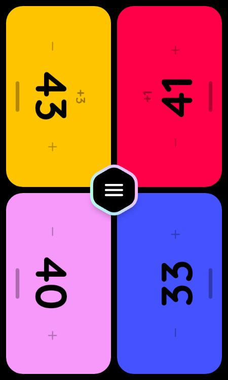
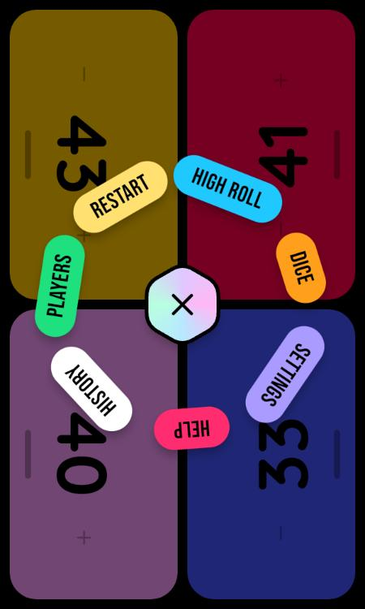
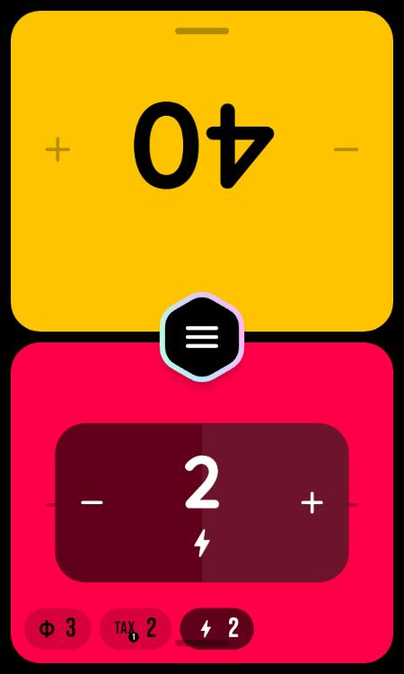
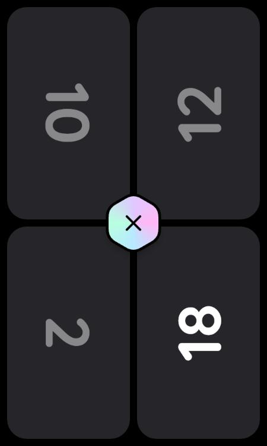
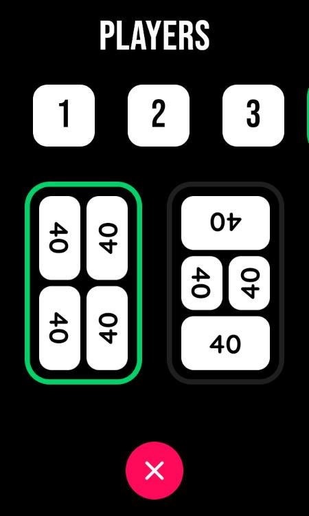
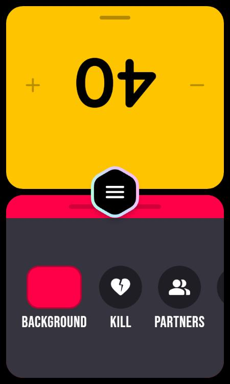
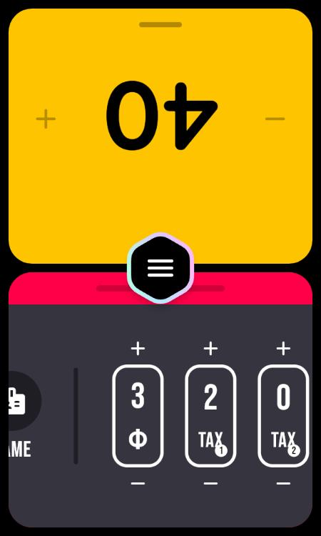
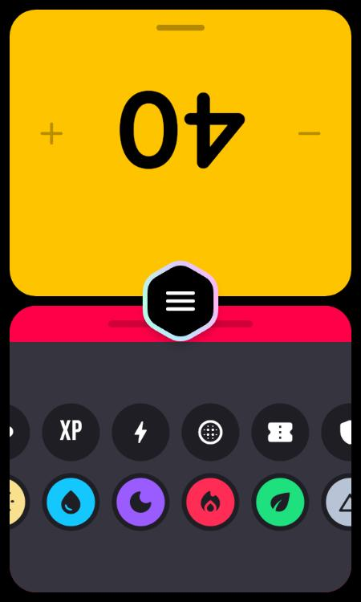
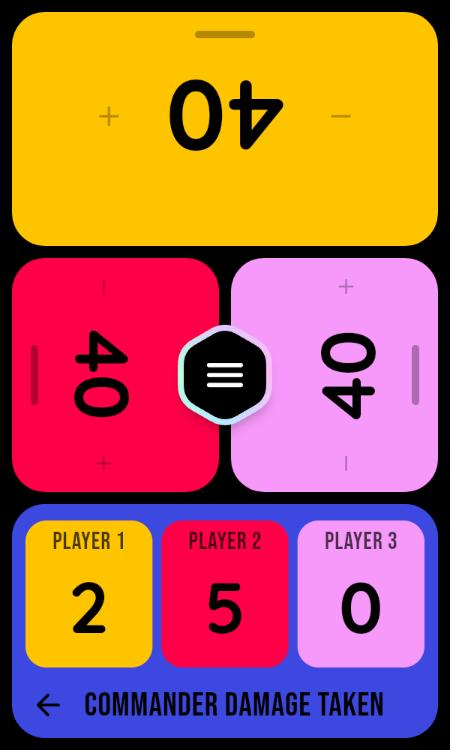

<h1 align="center">Life Counter</h1>

<p align="center">
  A bold, colorful life counter for Magic: The Gathering and other card games.<br>
  1–6 players around one phone, with poison, commander damage, mana and more.
</p>

<p align="center">
  
  &nbsp;
  
  &nbsp;
  
</p>

<p align="center">
  
  
  
</p>

---

## Features

- **1–6 players** with table layouts where every panel faces its player
- **Tap to count:** right half +1, left half −1. **Hold** for ±10, repeating while you hold
- **Recent change** shown above the total for 2 seconds (`+3`, `−5`)
- **Player drawer** (swipe up on a panel):
  - background color, kill / unkill, partners, name
  - steppers for **poison (Φ)**, **commander tax 1** and **tax 2**
  - counters for storm, experience, energy, rad, tickets, plus a **mana pool**
  - **commander damage**, **monarch** and **initiative**
- **Counter chips** on the panel. Tap one to edit it right there
- **Loss rules:** a player is out at 0 life, 10 poison or 21 damage from one commander
- **High Roll** to see who goes first (always a single winner)
- **Dice:** coin, D4, D6, D8, D10, D12, D20
- **History** of every life change
- **Settings:** starting life 20 / 25 / 30 / 40 / 50, keep the screen awake,
  and whether commander damage also lowers life

## How to use

### The board


Each player has a colored panel turned toward them.

| Do this | What happens |
| --- | --- |
| Tap the **right** half | +1 life |
| Tap the **left** half | −1 life |
| **Hold** either half | ±10, repeating |
| Tap the **center hexagon** | Opens the menu |

The small faded `−` and `+` show which side is which.

<br clear="right">

### The menu


Tap the hexagon in the middle. The buttons sit in a ring so players on
every side can read one of them.

- **Restart**: everyone back to starting life
- **High Roll**: everyone rolls a d20
- **Dice**: roll a coin or any die
- **Settings**, **Help**, **History**
- **Players**: number of players and layout

<br clear="right">

### High Roll



Every player gets a different number from 1 to 20. The highest stays bright
white and the rest fade. Tap ✕ to go back to the game.

<br clear="right">

### Players and layouts



Pick how many people are playing, then pick a layout. For example, four
players can sit two on each side, or one at each end and two along the sides.

<br clear="right">

### The player drawer



**Swipe up** on a panel, or tap the small bar at its bottom. The panel shrinks
to a strip and the drawer opens below it. Swipe down or tap the strip to close it.

Scroll sideways for more:

1. **Background, Kill, Partners, Name**
2. **Steppers:** poison, tax 1, tax 2
3. **Counter grid:** storm, XP, energy, rad, tickets, commander damage,
   monarch, initiative and the mana pool

<br clear="right">

<p>
  
  &nbsp;
  
</p>

### Counter chips


Any counter above 0 shows as a chip in the panel's bottom-left corner.
Tap a chip and a small dark editor opens over the life total:

- left half = −1, right half = +1
- tap anywhere outside it to close

A counter you bring back to 0 disappears.

<br clear="right">

### Commander damage



Open the drawer and tap the **shield**. You get one tile per opponent in their
color (two if they have **Partners**). Tap the right half of a tile when that
commander hits you.

By default this also lowers your life. You can turn that off in Settings.
21 damage from one commander knocks you out.

<br clear="right">

## Run it

You need the [Flutter SDK](https://docs.flutter.dev/get-started/install).

```bash
flutter pub get
flutter run              # phone or emulator
flutter run -d chrome    # in the browser (or -d edge)
flutter test             # run the tests
```

> **Android release builds:** the fonts are downloaded when the app runs, so add
> `<uses-permission android:name="android.permission.INTERNET"/>` to
> `android/app/src/main/AndroidManifest.xml`.

## Project structure

```
lib/
├── main.dart                  app setup, portrait lock, theme
├── game_state.dart            players, life, counters, commander damage, history
├── layouts.dart               table layouts (which way each panel faces)
├── theme.dart                 fonts and colors
├── screens/
│   ├── game_screen.dart       the board and the ring menu
│   ├── players_screen.dart    player count and layout picker
│   ├── settings_sheet.dart
│   ├── dice_sheet.dart
│   └── history_sheet.dart
└── widgets/
    ├── player_panel.dart      one player's panel, drawer and counter editor
    ├── counter_glyph.dart     counter symbols (Φ, TAX, icons)
    ├── hex_button.dart        the center hexagon
    └── radial_menu.dart       the ring of menu buttons
test/
└── widget_test.dart           game rules and UI tests
```
